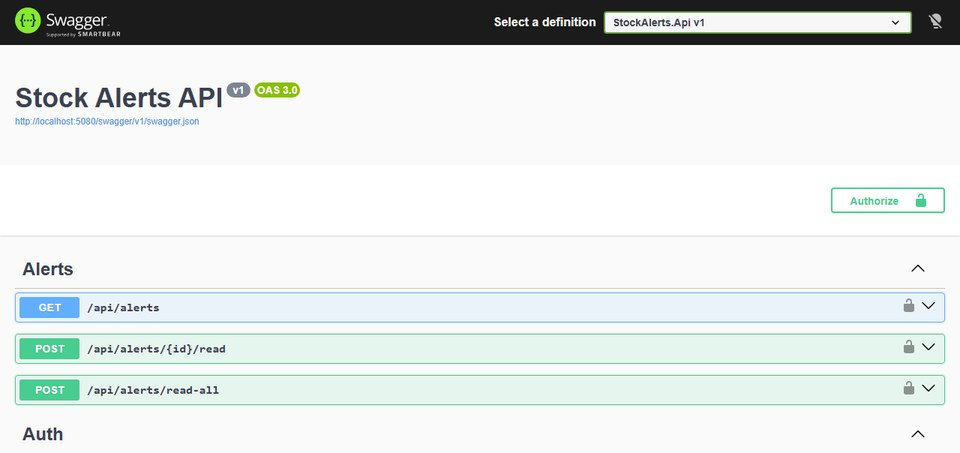
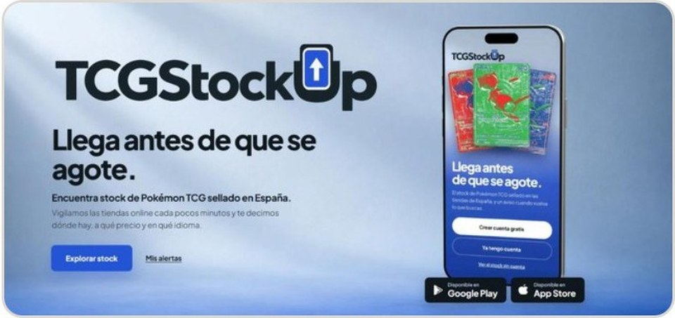
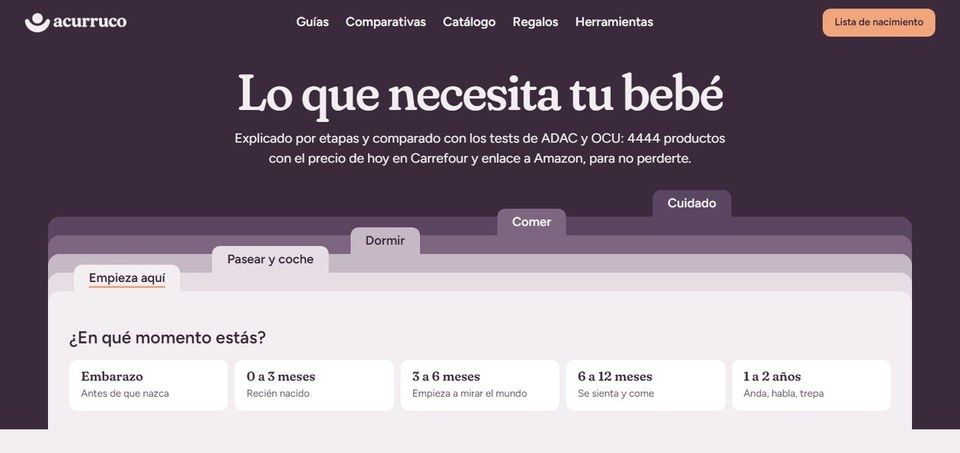
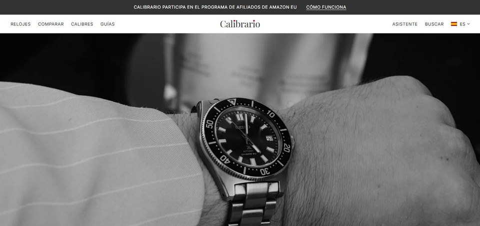
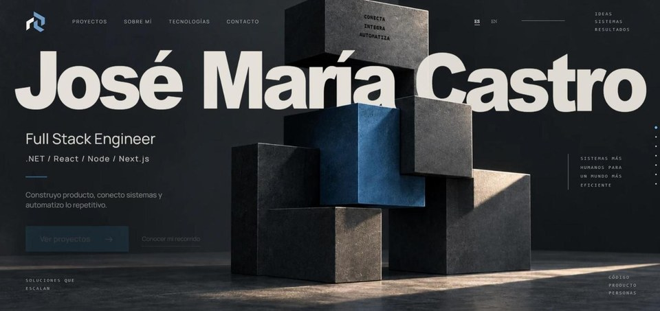

  

  
  

Senior Full Stack Developer en Madrid. Llevo 7 años construyendo aplicaciones web de principio a fin: .NET en el backend, React en el frontend y SQL Server en los datos.

- Ahora en **Q2B Studio**, con aplicaciones a medida para clientes de retail, textil, industria, recursos humanos, vending y e-commerce.
- Antes en **Babel**, como desarrollador principal de uno de los módulos de una plataforma de seguridad y salud laboral.
- Uso IA a diario (Claude, Cursor, n8n) para ir más rápido en lo mecánico y dedicar el tiempo a las decisiones técnicas.

## Stack

  
  
  
  
  
  
   
  
  
  
  
  
  
  
   
  
  
  
  
  
  
  
  

## Proyectos

El código .NET de mi trabajo es de clientes y no es público. Como muestra de cómo programo en .NET está **stock-alerts-api**; el resto son proyectos propios.

<table>
  <tr>
    <td width="50%" valign="top">
      
      <h3><a href="https://github.com/josemcastrodev/stock-alerts-api">stock-alerts-api</a></h3>
      
API REST de ejemplo que avisa cuando un producto vuelve a tener stock: una versión simplificada, en .NET, del backend de TCG Stock Up.

      
C# · ASP.NET Core · EF Core · SQL Server · JWT · xUnit · Docker · GitHub Actions

    </td>
    <td width="50%" valign="top">
      
      <h3><a href="https://tcgstockup.com">TCG Stock Up</a></h3>
      
App para iOS, Android y web que avisa cuando vuelve el stock de Pokémon TCG en tiendas españolas. Más de 500 usuarios registrados.

      
Expo · React Native · TypeScript · NestJS · PostgreSQL · Playwright · Cloudflare Workers

    </td>
  </tr>
  <tr>
    <td width="50%" valign="top">
      
      <h3><a href="https://gochi.es">Gochi</a></h3>
      
Red social para puntuar restaurantes y descubrir sitios por la gente en la que confías. iOS y Android.

      
Expo · React Native · TypeScript · Supabase · Astro · RevenueCat

    </td>
    <td width="50%" valign="top">
      
      <h3><a href="https://github.com/josemcastrodev/acurruco">Acurruco</a></h3>
      
Guías y catálogo para el primer año del bebé, con el catálogo actualizado cada día de forma automática.

      
Astro · TypeScript · Python · GitHub Actions · Cloudflare Pages

    </td>
  </tr>
  <tr>
    <td width="50%" valign="top">
      
      <h3><a href="https://github.com/josemcastrodev/calibrario">Calibrario</a></h3>
      
Comparador de relojes automáticos en cinco idiomas.

      
Astro · TypeScript · Cloudflare Pages

    </td>
    <td width="50%" valign="top">
      
      <h3><a href="https://github.com/josemcastrodev/josemcastro-portfolio">josemcastro.dev</a></h3>
      
Mi portfolio, con prerenderizado propio para buscadores y asistentes de IA.

      
React 19 · Vite · GSAP · Cloudflare Pages

    </td>
  </tr>
</table>
