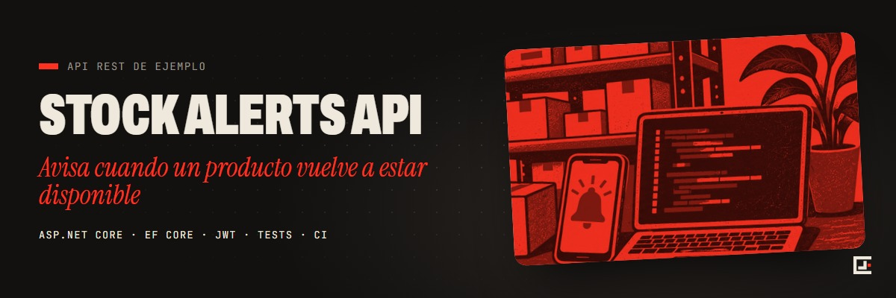
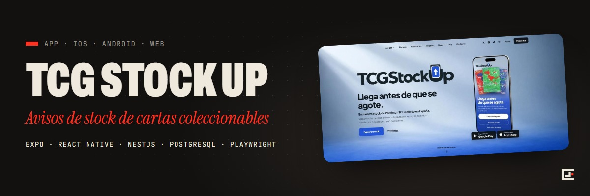
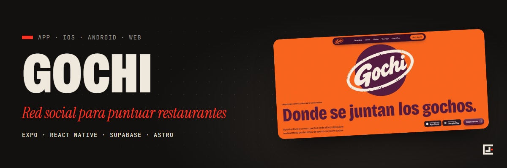
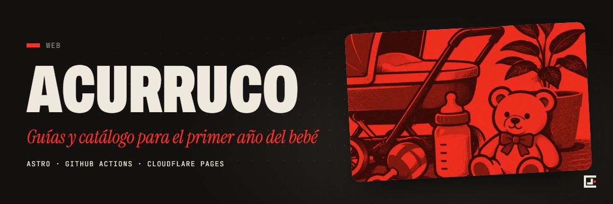
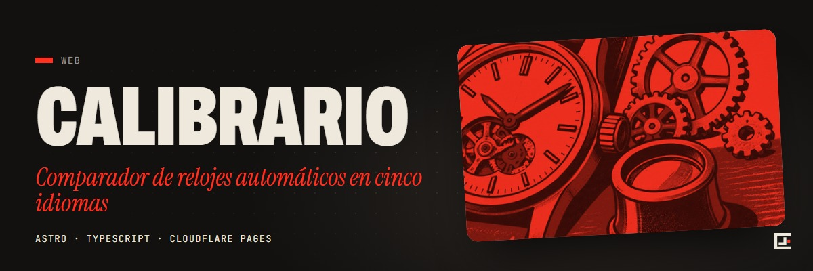
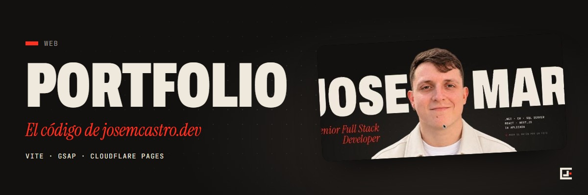

  

  <a href="https://josemcastro.dev"><b>josemcastro.dev</b></a>
  &nbsp;·&nbsp;
  <a href="https://www.linkedin.com/in/josemcastrop/"><b>LinkedIn</b></a>

Senior Full Stack Developer en Madrid. Llevo 7 años construyendo aplicaciones web de principio a fin: .NET en el backend, React en el frontend y SQL Server en los datos.

- Ahora en **Q2B Studio**, con aplicaciones a medida para clientes de retail, textil, industria, recursos humanos, vending y e-commerce.
- Antes en **Babel**, como desarrollador principal de uno de los módulos de una plataforma de seguridad y salud laboral.
- Trabajo a diario con IA: programo con agentes en Claude Code y Cursor (con servidores MCP), integro modelos de lenguaje (LLM) por API y automatizo procesos con n8n.

## Stack

<table>
  <tr><td><b>Backend</b></td><td>C# · .NET · ASP.NET Core · Entity Framework · Node.js · NestJS</td></tr>
  <tr><td><b>Datos</b></td><td>SQL Server · PostgreSQL</td></tr>
  <tr><td><b>Frontend</b></td><td>TypeScript · React · Next.js · Vue</td></tr>
  <tr><td><b>Móvil</b></td><td>React Native · Expo</td></tr>
  <tr><td><b>Cloud y herramientas</b></td><td>Azure · Azure DevOps · Cloudflare · Git</td></tr>
  <tr><td><b>IA</b></td><td>Claude Code · Cursor · agentes de IA · LLM por API · MCP</td></tr>
  <tr><td><b>Automatización</b></td><td>n8n · Playwright</td></tr>
</table>

## Proyectos

El código .NET de mi trabajo es de clientes y no es público. Como muestra de cómo programo en .NET está **stock-alerts-api**; el resto son proyectos propios.

<table>
  <tr>
    <td width="50%" valign="top">
      
      
<b><a href="https://github.com/josemcastrodev/stock-alerts-api">stock-alerts-api</a></b> API REST de ejemplo que avisa cuando un producto vuelve a tener stock: una versión simplificada, en .NET, del backend de TCG Stock Up.

      
C# · ASP.NET Core · EF Core · SQL Server · JWT · xUnit · Docker · GitHub Actions

    </td>
    <td width="50%" valign="top">
      
      
<b><a href="https://tcgstockup.com">TCG Stock Up</a></b> App para iOS, Android y web que avisa cuando vuelve el stock de Pokémon TCG en tiendas españolas. Más de 600 usuarios registrados.

      
Expo · React Native · TypeScript · NestJS · PostgreSQL · Playwright · Cloudflare Workers

    </td>
  </tr>
  <tr>
    <td width="50%" valign="top">
      
      
<b><a href="https://gochi.es">Gochi</a></b> Red social para puntuar restaurantes y descubrir sitios por la gente en la que confías. iOS y Android.

      
Expo · React Native · TypeScript · Supabase · Astro · RevenueCat

    </td>
    <td width="50%" valign="top">
      
      
<b><a href="https://github.com/josemcastrodev/acurruco">Acurruco</a></b> Guías y catálogo para el primer año del bebé, con el catálogo actualizado cada día de forma automática.

      
Astro · TypeScript · Python · GitHub Actions · Cloudflare Pages

    </td>
  </tr>
  <tr>
    <td width="50%" valign="top">
      
      
<b><a href="https://github.com/josemcastrodev/calibrario">Calibrario</a></b> Comparador de relojes automáticos en cinco idiomas.

      
Astro · TypeScript · Cloudflare Pages

    </td>
    <td width="50%" valign="top">
      
      
<b><a href="https://github.com/josemcastrodev/josemcastro-portfolio">josemcastro.dev</a></b> Mi portfolio: animación ligada al scroll, un retrato que se convierte en código y fuentes alojadas en el propio sitio.

      
Vite · GSAP · JavaScript · Cloudflare Pages

    </td>
  </tr>
</table>
